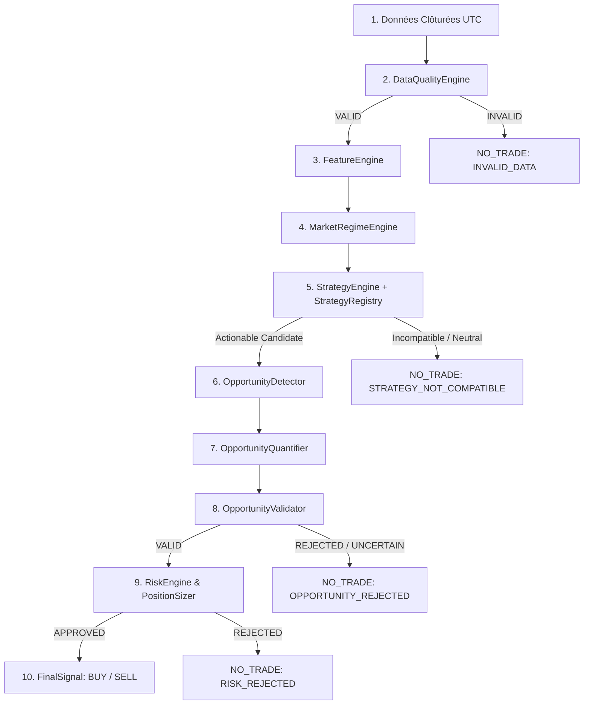

# Architecture Système — ATIP V1

> **Document :** Architecture canonique et décisions structurantes (ADR)  
> **Dernière mise à jour :** 16 Octobre 2026 (Phase 1 & 2)

---

## 1. Principes Fondateurs

1. **Isolation stricte de l'exécution en V1** :
   La plateforme ATIP est un système de **recherche quantitative, d'analyse causale et de simulation (paper trading)**. Zéro ordre réel n'est exécuté en V1. Tout déclenchement d'ordre réel est verrouillé à 3 niveaux indépendants.
2. **Causalité temporelle et anti-lookahead** :
   Aucun calcul d'indicateur, swing, régime, signal ou décision de risque ne peut consommer de données à un instant $T' > T$. Tous les tests anti-lookahead avec mutation du futur doivent rester 100% invariants.
3. **Chemin décisionnel canonique unique** :
   Le backtest, le replay historique, le paper trading et l'API de surveillance utilisent exactement la même chaîne de décision (`ATIPPipeline`). Seule la couche d'exécution (simulation déterministe vs paper ledger) diffère.

---

## 2. Chaîne Décisionnelle Canonique (`ATIPPipeline`)



### Détail des 9 Étapes Canoniques :
1. **Données Clôturées** : Reçues en UTC du broker (natif ou mock) ou du replay de backtest.
2. **DataQualityEngine** : Contrôle OHLC, timestamps croissants, absence de NaN, détection des gaps anormaux et fraîcheur.
3. **FeatureEngine** : Calcul des caractéristiques mathématiques causales (EMA, SMA, RSI, ATR, VWAP, Bollinger, Volume, Momentum).
4. **MarketRegimeEngine** : Classification du régime (`TRENDING_BULL`, `TRENDING_BEAR`, `RANGING`, `UNCERTAIN`).
5. **StrategyEngine & StrategyRegistry** : Évaluation des seules stratégies `ENABLED` compatibles avec le régime (actuellement Trend Following et Mean Reversion). Les stratégies expérimentales sont visibles dans le catalogue mais exclues par défaut.
6. **OpportunityDetector** : Détection structurée de l'opportunité (prix d'entrée, références d'invalidation, preuves factuelles).
7. **OpportunityQuantifier** : Calcul d'un score de confiance pondéré (0 à 100).
8. **OpportunityValidator** : Filtrage selon le seuil minimal de conviction et de consistance.
9. **RiskEngine & PositionSizer** : Vérification des limites du compte (drawdown max, nombre de positions, spread) et dimensionnement strict de la position en lots respectant les spécifications du broker.
10. **SignalEngine.generate_signal** : Émission du `FinalSignal` immuable avec audit trail complet.

---

## 3. Architecture des Composants

```
core/
├── data/              # Collecte, normalisation et validation qualité
├── features/          # Calculateurs causaux enregistrés via FeatureRegistry
├── regime/            # Détection et classification des régimes de marché
├── strategy/          # Catalogue de stratégies et StrategyRegistry
│   ├── registry/      # Registre centralisé, gestion des statuts et métadonnées
│   └── strategies/    # Stratégies concrètes (MacroTrend, Breakout, Fib, MTF, etc.)
├── opportunity/       # Détecteur, quantifieur et validateur d'opportunités
├── risk/              # RiskEngine, RiskLimitsChecker, PositionSizer
├── signal/            # SignalEngine, 5 validation gates, domaine FinalSignal
├── pipeline.py        # Pipeline canonique ATIPPipeline & PipelineResult
├── backtest/          # Moteur de replay déterministe, métriques R, capital dynamique
├── paper_trading/     # Forward streaming, PaperBroker, ledger append-only
├── execution/         # Abstraction d'exécution avec Safety Lock strict
└── monitor/           # Surveillance continue des bougies clôturées
```

Le module `core/backtest/walk_forward.py` découpe exclusivement des fenêtres chronologiques. Il refuse les timestamps manquants ou dupliqués et les configurations sans progression ; les résultats hors-échantillon n'incluent que les signaux et trades postérieurs au début de leur fenêtre de test.

---

## 4. Architecture Decision Records (ADR)

### ADR-001 : Unification de `StrategyEngine` et Introduction de `StrategyRegistry`
- **Contexte :** Deux fichiers `engine.py` et `StrategyEngine.py` coexistaient avec une logique redondante, créant des risques de divergence. De plus, les stratégies étaient instanciées en dur sans gestion de métadonnées, de statut ou de timeframes compatibles.
- **Décision :** 
  1. Conserver `core/strategy/services/engine.py` comme implémentation unique canonique de `StrategyEngine`.
  2. Remplacer `core/strategy/services/StrategyEngine.py` par un alias de ré-export pour garantir la rétrocompatibilité.
  3. Introduire `core/strategy/registry/registry.py` (`StrategyRegistry`) pour gérer le cycle de vie des stratégies (`ENABLED`, `DISABLED`, `EXPERIMENTAL`, `UNSUPPORTED_DATA`), les classes d'actifs et les timeframes autorisés.
- **Conséquences :** Modularité accrue, ajout aisé de nouvelles stratégies sans modifier le pipeline, traçabilité des versions de stratégies.

### ADR-002 : Gestion Dynamique du Capital dans `BacktestRunner`
- **Contexte :** Les tests de dynamique de capital nécessitaient que le `BacktestRunner` mette à jour le solde virtuel du compte au fur et à mesure que les trades simulés se clôturent, afin que le `RiskEngine` dimensionne les lots sur la base de l'équité réelle à chaque instant $T$.
- **Décision :** 
  1. Ajouter `self.account` dans `BacktestRunner` initialisé avec `initial_capital`.
  2. Implémenter `_update_account_after_closed_trades(closed_trades, active_trades_count)` pour recalculer le balance, l'équité et le daily PnL.
  3. Implémenter `_reset_daily_pnl_if_new_day(current_ts, previous_ts)` basé sur le passage à une nouvelle date calendrier UTC.
  4. Réinitialiser le compte au début de chaque `run()`.
- **Conséquences :** 100% de parité entre simulation backtest et exécution forward ; le calcul du risque reflète fidèlement la progression du capital sans fuite d'information.

### ADR-003 : Verrouillage Triple de l'Exécution en V1
- **Contexte :** L'adaptateur `MT5ExecutionAdapter` contenait du code d'envoi d'ordres réels `mt5.order_send()`.
- **Décision :** 
  1. Au niveau de la configuration : `Settings.trading_execution_enabled = False` par défaut.
  2. Au niveau du routeur API : `apps/api/routers/execution.py` n'est pas inclus dans `apps/api/main.py`.
  3. Au niveau de l'adaptateur de service : `MT5ExecutionAdapter.execute_order()` vérifie impérativement `trading_execution_enabled`. Si `False`, l'exécution est immédiatement bloquée avec un code retour `-403`, un statut `FAILED` et une trace d'audit explicite `BLOCKED_BY_SAFETY_GUARD_EXECUTION_DISABLED`.
- **Conséquences :** Impossibilité structurelle de déclencher un ordre réel par accident ou mauvaise configuration.

### ADR-004 : Exposition de `risk_proposal` sur `PipelineResult`
- **Contexte :** Le résultat du pipeline analytique ne contenait pas l'objet `risk_proposal`, empêchant les tests d'intégration et les outils d'audit de vérifier la parité des propositions de risque entre backtest et forward.
- **Décision :** Ajouter `risk_proposal: Optional[OrderProposal] = None` sur la dataclass `PipelineResult` et le propager systématiquement dans `ATIPPipeline.process()`.
- **Conséquences :** Parité déterministe validée entre le mode historique et le mode forward.

### ADR-005 : Retrait des routes à fixtures de l'API publique
- **Contexte :** Les routes historiques de signal, régime et risque fabriquaient des valeurs d'exemple et pouvaient être confondues avec une analyse de marché.
- **Décision :** Ne plus monter ces routeurs dans `main.py`. Exposer le chemin canonique via `GET /api/v1/decision/{symbol}`, qui construit le snapshot à partir des bougies clôturées du broker configuré puis passe par `ATIPPipeline`.
- **Conséquences :** Une configuration `mock` est toujours clairement une démonstration, et aucune donnée fixture n'est présentée comme une décision live. Aucune route d'exécution n'est montée.

### ADR-006 : Livraison de notification SMTP opt-in
- **Contexte :** Le service de notification n'avait qu'un adaptateur mock et ne pouvait livrer un message lorsqu'un opérateur configurait une destination.
- **Décision :** Ajouter un adaptateur SMTP fondé sur la bibliothèque standard, sélectionné seulement quand `NOTIFICATION_EMAIL_ENABLED=true` et que l'hôte, le port et l'expéditeur sont tous renseignés. Sinon, l'adaptateur est explicitement désactivé.
- **Conséquences :** Un canal réel est disponible sans secret dans Git. Les retries et la déduplication restent en mémoire ; ils ne survivent pas encore à un redémarrage et devront être persistés avant une exploitation durable.
